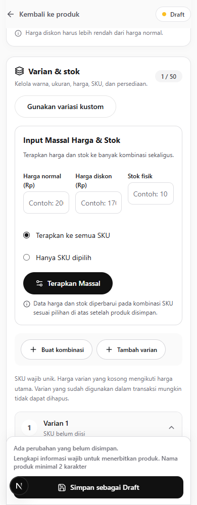
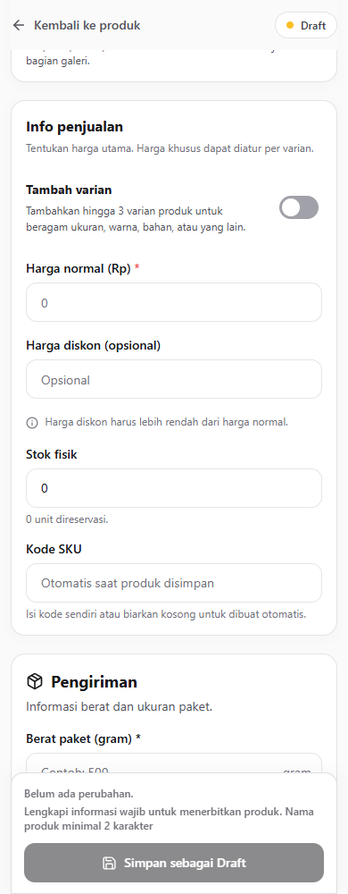
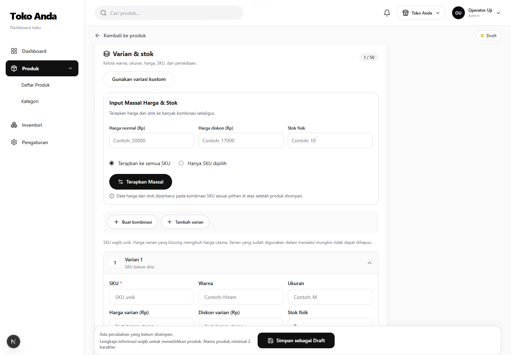
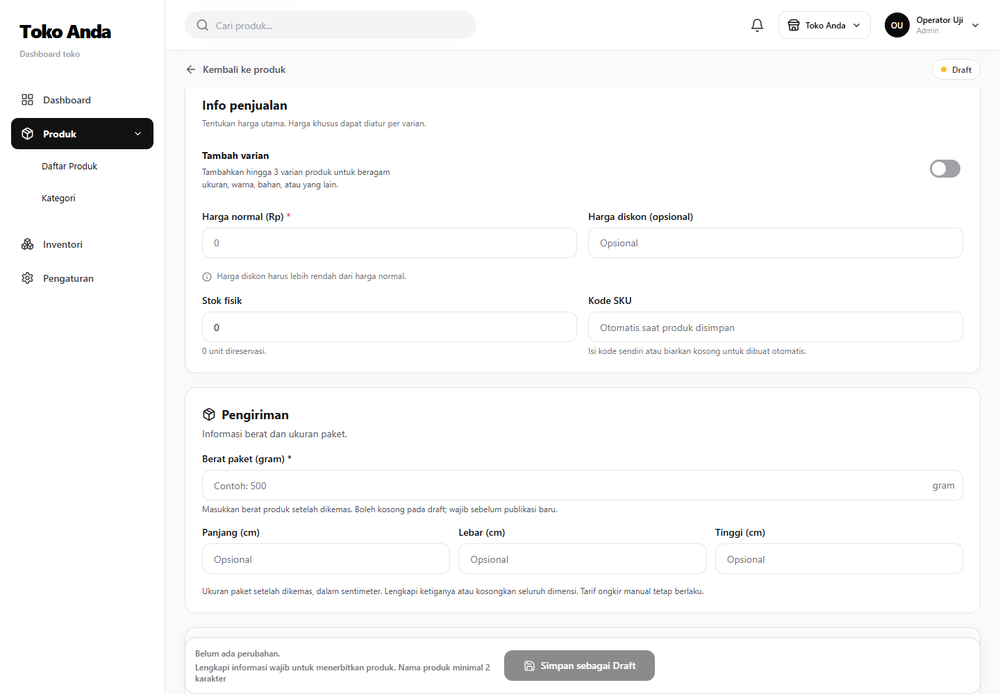
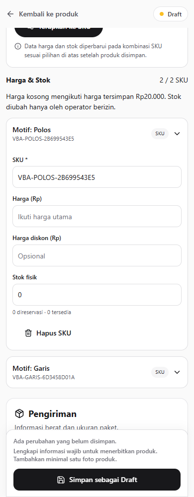
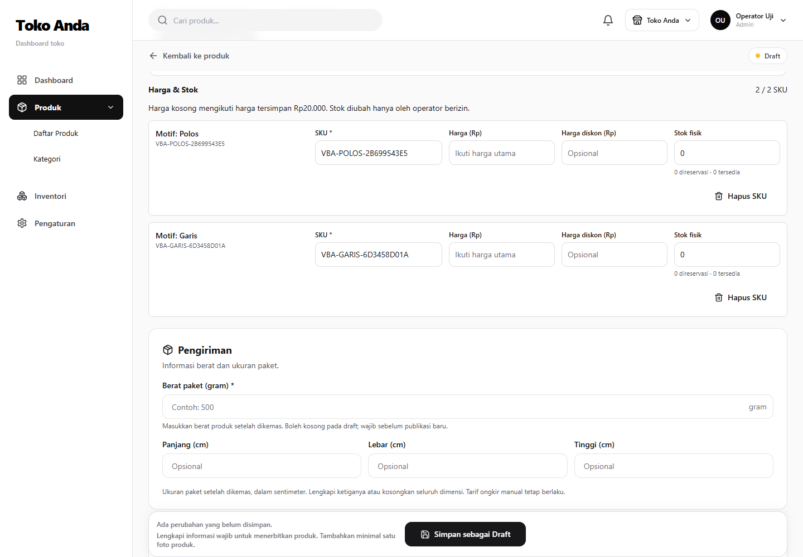

# Remediasi editor produk Hubify

## Baseline dan batas pekerjaan

Baseline produksi: v1.7.2, `5145bdcd7cd84f93f49a066aa669560e858db0ac`, sehat saat audit. `origin/main` masih v1.6.3 (`cc4e42e`); PR 36/37/38 merupakan pendahulu rilis produksi yang belum digabung. Worktree khusus `product-editor-remediation`, branch `fix/product-editor-sku-variant-remediation`. Tidak ada AGENTS.md dalam repository toko. Chat pengiriman sedang idle saat pemeriksaan. Rekonsiliasi ancestry main wajib diperiksa pada gate merge, bukan menghapus fitur produksi agar diff mengecil.

Brief menyebut screenshot, tetapi lampiran yang tersedia hanya teks. Bukti sebelum/sesudah akan diambil dari aplikasi lokal dengan data uji; tidak mengklaim pencocokan screenshot yang tidak tersedia. Skill emil-design-eng dibaca lengkap. Referensi UX: [TikTok Shop—produk baru](https://seller-uk.tiktok.com/university/essay?knowledge_id=7753824408553217&lang=en-GB) memisahkan SKU tunggal dan variasi; [Shopee—dua tingkat variasi](https://cdngarenanow-a.akamaihd.net/shopee/seller/help/sg/8d5351e212bf3187a184ab859eb2b780/Two-tiers%20variation.pdf) memperlihatkan pengisian harga/stok dan penerapan massal. Batas Hubify tetap 3 jenis, 50 opsi per jenis, 50 kombinasi, tanpa menyalin branding atau batas marketplace lain.

## Audit akar masalah

| Prioritas | Temuan dan rujukan | Dampak / keputusan |
| --- | --- | --- |
| P1 | `product-editor.tsx:valuesFor` selalu membuat satu baris kosong; state `custom` memakai `!initial` | Produk baru default variasi. Jadikan default produk biasa, pertahankan tepat satu SKU internal tanpa kartu Varian 1. |
| P1 | Cabang `!custom` selalu menampilkan editor warna/ukuran, bulk, dan baris `Varian ${index+1}` | Flag variasi kustom bukan representasi produk sederhana: produk legacy multi-SKU juga false. Bedakan simple, custom, dan legacy secara eksplisit. |
| P1 | `product-management.validation.ts` mewajibkan minimal satu varian; create service membuat inventory per variant | Ini kontrak data yang benar untuk cart/order, bukan alasan menampilkan kartu varian. Alokasikan kode SKU simple sebelum save, pertahankan ID saat edit. |
| P0 | `ProductVariant.sku @unique` case-sensitive; allocator mengecek insensitive tetapi save hanya memvalidasi duplikat exact | Tambah validasi insensitive di payload dan transaksi serializable sebelum write; uniqueness database dan retry tetap menjadi pertahanan terakhir. |
| P0 | `variation-domain.ts:combinationKey` mengurutkan ID; generator custom memakai Map dengan key ID | Identitas sudah stabil terhadap rename/reorder. Pertahankan mekanisme ini; jangan gunakan indeks/label untuk rekonsiliasi. |
| P0 | `assertStableSelection` memblokir semua perubahan identitas existing; UI memblokir semua SKU yang punya ID | Bedakan konversi eksplisit yang aman pada SKU tanpa stok, reservasi, cart, order, movement dari konversi berisiko. Konversi aman menjaga ID survivor; tidak memindahkan stok/histori. |
| P0 | Update service melindungi penghapusan berdasarkan onHand/reserved/order/cart/movements, tetapi belum melindungi edit kode SKU historis | Terapkan proteksi identitas/kode di server dan penjelasan readonly pada form. Opsi historis boleh rename tanpa mengubah snapshot order. |
| P1 | `canonicalProductPricing` mengganti basePrice/salePrice saat semua SKU punya harga | Harga fallback yang sah harus tetap eksplisit; jangan berubah karena generate/save opsi. Kompatibilitas bootstrap harga kosong client lama harus teruji. |
| P0 | `inventory.service.ts:adjustStock` memakai expectedOnHand, reservasi, updateMany kondisional; service memanggil hanya jika stok berubah | Pertahankan transaksi, otorisasi INVENTORY_READ/ADJUST, dan write receipt agar replay tidak menggandakan movement. |
| P0 | CartItem dan OrderItem memakai variantId; checkout menyalin productName, variantLabel, unitPrice | Edit biasa tidak membuat ulang SKU. Snapshot transaksi tetap tidak berubah; penghapusan referensi diblokir. |
| P1 | `writeOptionGroups` mengganti relasi dalam transaksi, mempertahankan group/value ID dan memakai nama sementara saat rename swap | Tetap jaga ownership gambar/grup, mapping gambar, serta proteksi SKU yang dihapus. Menambah dimensi pada SKU historis bukan reorder biasa. |
| P2 | `Button` default memakai token primary; portal editor berada di luar shell; CSS `.variation-tools-menu button` merah | Scope token/tombol monochrome pada editor dan portalnya, bukan override storefront/global. |
| P2 | Pesan Zod default untuk angka/string dan refine variant tanpa path field | Pesan Indonesia per field, ringkasan ber-tautan/fokus, dan validasi server tetap wajib. |
| P2 | Editor grup dan harga berada di modal fullscreen terpisah dengan child dialog foto/konfirmasi | Gunakan pengungkapan bertahap inline; desktop grid SKU editable, mobile accordion. Konfirmasi/foto menjadi satu modal aktif tanpa modal induk. |

### Harga, stok, dan kompatibilitas

`cart.service.ts:unitPriceFor` memprioritaskan promosi aktif, kemudian harga SKU eksplisit, kemudian fallback produk. Diskon SKU hanya berlaku bersama harga SKU; harga null mengikuti produk. UI simple memuat harga efektif SKU tunggal agar override lama tidak tersembunyi dan perubahan harga benar-benar berlaku. Listing/detail tetap memakai resolver yang ada; uji regresi mengonfirmasi hasilnya.

`serializeProduct` membawa ID SKU, expectedOnHand, protected, reserved, serta opsi legacy yang diturunkan secara deterministik dari color/size. Produk legacy tidak boleh otomatis dikonversi hanya karena dibuka. Save memakai product revision lock, transaksi Serializable dengan retry, dan receipt berbasis requestId/payload. Alokasi SKU adalah saran, bukan reservasi: konflik save harus tetap ditolak dengan pesan yang jelas.

## Rencana implementasi

1. P0: kontrak mode opsional yang kompatibel client lama; validasi SKU, aturan konversi aman, proteksi kode historis, regression database untuk identitas/replay/concurrency.
2. P1: default simple; harga/diskon/stok/SKU dalam Info penjualan; alokasi SKU otomatis tanpa menimpa kode existing/manual; field error dan readiness yang sesuai.
3. P1: variasi inline, generator rekonsiliasi berdasarkan ID, mempertahankan SKU survivor pada konversi aman, penjelasan dan konfirmasi saat data draft akan dilepas.
4. P2: editor harga/stok compact, target semua/terpilih, feedback jumlah SKU; desktop tabel, mobile accordion; scope monochrome termasuk portal.
5. P2: keyboard/focus/unsaved/loading dan screenshot 360/390/430/768/1024/1440/1920.
6. P3: unit/integration/pricing/inventory/build/lint; review keamanan; PR ke main; rekonsiliasi baseline; GO hanya setelah semua gate relevan lulus, lalu jalur update resmi, backup dan smoke produksi.

## Keputusan desain Emil

| Before | After | Alasan |
| --- | --- | --- |
| Produk biasa terlihat sebagai Varian 1 | Empat field penjualan langsung, tanpa kartu SKU | Mengikuti cara seller memikirkan satu produk. |
| Pengaturan grup dan harga tersembunyi pada modal bertingkat | Editor inline bertahap, foto/konfirmasi pada dialog tunggal | Menjaga konteks dan mengurangi perpindahan. |
| Kartu SKU panjang pada desktop | Baris harga/stok editable, accordion di mobile | Efisien pada layar lebar dan tetap bisa disentuh pada mobile. |
| Tombol operasional terpengaruh token merah | Token lokal #18181B/#27272A dan border #E4E4E7 | Konsisten tanpa mengubah tema toko. |
| Feedback massal tidak menyebut jumlah | Jumlah SKU + pengingat Simpan | Membedakan perubahan draft dan transaksi tersimpan. |

Input berulang tidak diberi animasi baru. Feedback tombol singkat dan aturan reduced motion dibatasi pada editor/portal. Target sentuh minimal 44px, fokus terlihat, status aria-live. Tidak menambah library animasi.

## Database dan rollback

Rencana awal tanpa migrasi: model saat ini mendukung SKU tunggal dan variasi. Konversi hanya pada data yang server buktikan aman, dalam transaksi yang sama dengan save. Backup sebelum rilis harus lulus restore scratch. Rollback aplikasi memakai versi sehat sebelumnya melalui mekanisme repository; tidak mengembalikan database lama atau menghapus transaksi. Jalur updater dan kompatibilitas versi diperiksa terpisah dari status GitHub Release. Tidak mengubah DNS/platform pusat/CI atau menjalankan transaksi eksternal nyata.

## Hasil eksekusi dan gate

Implementasi dan pengujian aplikasi selesai. Status akhir rilis NO-GO karena checksum dua migrasi historis berbeda; rincian berikut membedakan gate yang lulus dan blocker produksi.

### Implementasi dan hasil pengujian

- Produk baru default sederhana, empat field penjualan langsung, SKU kosong dialokasikan saat simpan. SKU internal tetap satu. Produk legacy berwarna/ukuran tetap dikenali sebagai variasi meskipun flag custom false.
- Variasi inline dengan opsi custom, reorder, generator identitas berdasarkan ID, bulk setelah kombinasi tersedia, accordion mobile dan baris editable desktop. SKU survivor dipertahankan saat konversi aman. SKU berstok/bersejarah readonly dan dilindungi server.
- Harga fallback yang valid tidak lagi diganti harga termurah SKU. Harga override simple ditampilkan/diedit sesuai harga efektif. Tidak ada perubahan formula checkout/promo.
- Validasi Indonesia dan inline, status simpan, perlindungan perubahan belum tersimpan, serta penguncian form selama transisi navigasi. Tidak ada migrasi baru atau pengubahan SQL existing.
- Helper deployment resmi diperbaiki di source agar mempertahankan Compose aktif (WhatsApp/updater termasuk token/socket mount). Helper baru BELUM dipasang di server; pemasangannya menunggu gate rilis.
- Tes boundary mengenali tiga identifier protokol WhatsApp lama melalui pengecualian exact dan file-scoped; cookie dan kontrak relay tidak diganti. Tes navigasi diperbarui sesuai halaman Pengaturan seller yang sudah ada pada baseline produksi.

| Pemeriksaan | Hasil |
| --- | --- |
| Unit/regresi aplikasi | 636 PASS, 3 skipped existing; 87 suite PASS, 1 skipped |
| PostgreSQL terisolasi `product_editor_test` | 21 PASS; transaksi nyata, tanpa data pelanggan |
| Installer/updater/helper | 58 PASS dalam container Linux terbatas, filesystem source readonly, network none |
| Typecheck | PASS |
| Build produksi Node 22 | PASS |
| ESLint | 0 error, 39 warning (terutama baseline img/unused) |
| Repository boundary | PASS |
| Browser build produksi | 14 kelompok pemeriksaan PASS; tidak ada page exception |
| Responsive | 360, 390, 430, 768, 1024, 1440, 1920; tanpa overflow halaman |
| Restore backup scratch | PASS; database sementara, media/config berhasil diekstrak; database live tidak ditimpa |
| Preflight mode Hubify | PASS setelah izin eksplisit pengguna menonaktifkan J&T Production |
| Pelestarian Compose aktif | PASS pada perbandingan readonly konfigurasi live dan kandidat |
| Kompatibilitas checksum migrasi | **FAIL — blocker rilis** |

### Pemetaan 63 skenario brief

Nomor merujuk daftar Q pada brief. Satu tes dapat mencakup beberapa skenario; ini bukan klaim menjalankan 63 transaksi produksi.

| Skenario | Bukti pengujian |
| --- | --- |
| 1–12 simple, harga/diskon/stok/SKU, satu SKU, tanpa Varian 1 | `product-editor-remediation` unit/database, `product-editor-browser.mjs`, `product-editor-v2` |
| 13–19 satu/banyak/custom grup, 2x3, 3x3, batas dan duplikat | `custom-variations`, database remediasi, unit validasi case-insensitive |
| 20–24 harga/diskon/stok SKU dan bulk | `product-editor-v2`, database remediasi, browser bulk dengan count dan reminder |
| 25–30 reorder/rename/tambah/hapus aman/proteksi/mapping gambar | `custom-variations`, database remediasi termasuk mapping image dan survivor |
| 31–38 konversi draft/existing/unsafe dan referensi | unit survivor, database konversi dua arah, stok, cart dan snapshot order |
| 39–45 inheritance/fallback/harga/cart/checkout/regresi | `product-size-chart`, `money`, `flash-campaign`, `checkout-confirmation`, `checkout-shipping-stability`, database cart |
| 46–50 reservasi/adjustment/concurrency/idempotency/reset | database reservasi simultan, stale adjustment, replay receipt dan no-op save |
| 51–55 izin/validasi/session/modifikasi unauthorized | `product-management`, `auth-actions`, checkout action tests, database permissions, validasi input |
| 56–63 responsive/keyboard/modal/inline/style/unsaved/loading/success | browser produksi, 14 kelompok assertion dan 14 screenshot responsif |

Regresi unit mencakup pengiriman, kupon/flash sale, keranjang, checkout, alur order/refund, auth, WhatsApp dan identitas toko. Tidak melakukan order, pembayaran, refund, atau request J&T Production nyata. Pengujian UI produksi kandidat belum dilakukan karena deployment ditahan.

### Bukti visual

| Sebelum v1.7.2 | Sesudah kandidat |
| --- | --- |
|  |  |
|  |  |

Screenshot memakai data sintetis pada database lokal. Baseline dijalankan dari checkout persis SHA v1.7.2, kandidat diambil dari build produksi lokal.

### Blocker riwayat migrasi — NO-GO

Helper resmi menolak dua checksum existing. SQL yang dinormalisasi per baris identik; file historis yang tersimpan di VPS memiliki CRLF/mixed endings. Ini bukan migrasi yang diubah oleh pekerjaan editor ini. Perbedaan sudah ada antara baseline v1.7.2/main dan ledger Hubify.

| Migrasi | Ledger / artefak historis | Repository v1.7.2 dan kandidat |
| --- | --- | --- |
| `20261109120000_order_resolution_workflow` | `789ef757b2cb2fb6f6d38f710c6a50cfcb371d9b61e18e4154120930e02107ac` | `865ec38af4482060322ba0dc89becc9132881d7bbb7f7e633b669af30e0444ec` |
| `20261109121500_resolution_transfer_review` | `d67b0094191575be2f28c7968e41eabad5bf9a9ab84676d8c66b7e7c01313483` | `22cb34b1d3840926b42356fb333c0678f5a0ea850ee3c3b8b1f9373cc92a885b` |

Bukti readonly: file historis pada `/opt/single-store/development-sources/7061d3575be5f1e999aa4369f12fc1979f4eaed6/app/prisma/migrations/` cocok dengan ledger. Migrasi pertama 3116 byte vs 3097 byte (19 CRLF), kedua 356 vs 354 byte (2 CRLF). Tidak menulis `_prisma_migrations`, tidak memalsukan metadata, tidak mengubah checksum validator, dan tidak mengubah file SQL untuk memaksa deployment. Rekonsiliasi perlu menilai kompatibilitas instalasi Hubify historis dan instalasi baru dari rilis LF; tidak cukup mengganti checksum agar guard lewat.

Rekomendasi **NO-GO untuk merge, tag, publikasi dan deployment v1.7.3** sampai rekonsiliasi historis diselesaikan melalui perubahan tersendiri yang direview dan diuji. Branch dan PR dapat ditinjau sekarang. Tidak ada tag/release v1.7.3 dibuat.

### Mode uji dan rollback

Pengguna mengotorisasi pengalihan Hubify ke mode uji. Kedua flag `JNT_PRODUCTION_ORDER_APPROVED` dan `JNT_PRODUCTION_API_APPROVED` kini `no`, diverifikasi dalam container aplikasi. Aplikasi v1.7.2 SHA 5145bdc tetap aktif dan sehat. Konfigurasi sebelum perubahan disimpan root-only di `/etc/single-store/runtime.env.before-editor-test-mode-20261111`. Tidak mengubah konfigurasi platform pusat, DNS, kredensial, atau konfigurasi WhatsApp/updater.

Backup `/var/backups/single-store/20261111-033438-9d2f6c1c` berhasil dipulihkan ke database scratch oleh `restore.sh --check`; 4 produk, 3 user dan 1 identitas pada backup diperiksa tanpa menimpa live. Deployment kandidat belum terjadi, sehingga tidak ada rollback kode kandidat. Setelah gate lulus, workflow resmi membuat backup baru dan mendukung `sudo /usr/local/sbin/hubify-staging-deploy --rollback`. Jangan memulihkan konfigurasi J&T lama tanpa otorisasi untuk mengaktifkan kembali Production.
